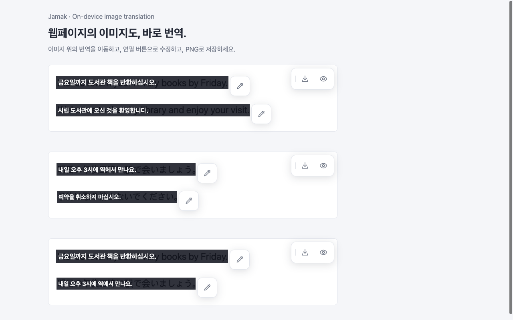

<p align="center">
  
</p>

<h1 align="center">Jamak</h1>

<p align="center">On-device subtitles and image translation for Chrome.</p>

<p align="center">
  <a href="#getting-started">Getting started</a> ·
  <a href="docs/README.md">Documentation</a> ·
  <a href="#contributing">Contributing</a> ·
  <a href="PRIVACY.md">Privacy</a> ·
  <a href="LICENSE">MIT License</a>
</p>

**Jamak** (자막, Korean for “subtitles”) turns browser audio and image text into Korean, English or Japanese. Speech recognition, OCR, translation and speaker analysis run on your device. No API key or companion app required.

## Features

- **Live subtitles** — Caption the current tab's audio, including videos and embedded players, with streaming translations and fullscreen support.
- **Three languages** — Choose English, Japanese or Korean speech, or detect the language automatically. Select the subtitle language independently.
- **Image translation** — Translate one image or all images on a page, move the labels, correct text inline and export a PNG. Original images stay untouched.
- **Speaker colors and history** — Distinguish speakers by caption background color and open original/translated text in a separate history window.
- **Local model choices** — Use Chrome's speech and translation packs, or choose Whisper, Hy-MT2 and PaddleOCR models in Advanced settings.
- **Background preparation** — Download models once and reuse cached files. Preparation continues after settings closes, with shared progress, Stop and retry controls.

| Live subtitles | Image translation |
| --- | --- |
|  |  |

Demo captures using synthetic speech and text images.

## Getting started

Requires **desktop Chrome 138+** and **Node.js 22.12+** to build from source. Chrome's local speech and translation APIs depend on device and language-pack availability. Automatic speech detection, Korean speech and Whisper recognition require **WebGPU with FP16 support**, as does optional Hy-MT2 translation.

```sh
git clone https://github.com/norux/jamak.git
cd jamak
npm ci
npm run build
```

1. Open `chrome://extensions` and enable **Developer mode**.
2. Click **Load unpacked** and select `apps/chrome/dist`.
3. Open a page and click Jamak in the extension toolbar.

First use needs internet access to download language packs and model files. Availability and preparation time vary by browser and hardware.

### Live subtitles

1. Open **오디오** (Audio). Choose the speech and subtitle languages, or enable **자동 감지** for multilingual speech. Defaults are English speech and Korean subtitles.
2. Click **모델 준비** (Prepare models) and wait until ready.
3. Click **번역 시작** (Start) and play audio in the tab. Click **중지** (Stop) to end capture.

Speech matching the subtitle language appears as its original text. Chrome defaults prefer local streaming recognition for manual English/Japanese; Korean, automatic mode and unsupported native speech use Whisper.

### Image translation

1. Open **이미지** (Image) and choose the output language.
2. Choose **탭의 모든 이미지 번역** (All images) or **이미지 선택해서 번역** (Select an image).
3. Drag labels to reposition them, use the adjacent pencil to edit text, and save with **PNG 저장**. The eye icon toggles caption visibility; **Aa** presets in the popup change text size.

Keep the source tab active when screenshot capture is needed. Image analysis runs independently of audio; stopping it keeps completed results available for PNG export.

### Model settings

Open **Advanced · 모델 선택** to choose recognition, translation, audio language detection, speaker analysis and image OCR models. Translation is shared by Audio and Image.

Changing a model stops the previous audio session and starts one preparation flow for audio/translation and OCR. Changing translation or OCR also retires incompatible image inference. Closing settings keeps preparation running; Stop/retry retains verified downloads. Advanced sends a Chrome notification when every stage is ready, subject to OS notification settings.

See the [model inventory and requirements](docs/architecture/media-framework.md#models) and [measured model comparisons](docs/verification/model-quality-20261025.md).

## Limitations

- **Desktop Chrome only.** iPhone Safari and a macOS app are planned.
- **Tab audio only.** Microphone and system-wide audio capture are not supported. Restricted Chrome pages cannot display overlays.
- **Results can change.** Live captions revise as speech continues. Noise, overlapping voices and short utterances can reduce accuracy; automatic language switching follows speech pauses. Recognition and translation can miss meaning or misinterpret words.
- **Image coverage is limited.** Image mode scans displayed `` elements in the main document. CSS backgrounds, iframe images and later additions are excluded. Screenshot fallbacks may be clipped or obscured.
- **OCR works best on printed English/Japanese.** Handwriting remains experimental; Korean OCR accuracy is not established. Short or ambiguous text may need manual correction. See [image verification and known limits](docs/verification/image-translation.md).

## Privacy

Audio, images, transcripts, translations and speaker features are processed locally and are not sent to external inference servers. Initial model downloads contact external providers. Transcript history stays in memory and may remain after Stop in the background runtime or an open history window. See the [privacy policy](PRIVACY.md) for retention, downloads and permissions.

## Contributing

Bug reports and focused pull requests are welcome. Read the [architecture](docs/architecture/media-framework.md), [coding conventions](docs/coding-conventions.md) and [agent instructions](AGENTS.md) before making changes.

```sh
npm ci
npx playwright install chromium
npm run dev
```

The dev command watches builds, serves conversation fixtures at `http://127.0.0.1:8790` and opens an isolated Chrome for Testing profile with the extension loaded. Port 8790 must be free. Reload the extension manually after rebuilds; Ctrl+C closes the owned development processes while preserving model caches.

Run the default checks before opening a pull request:

```sh
npm run verify
```

This runs lint, type checks, the build, unit/fixture tests and caption display checks. Real audio, OCR and model checks have separate prerequisites; see [Testing](docs/testing.md). Feature changes must keep README, AGENTS and relevant docs in sync.

More: [Documentation index](docs/README.md) · [Chrome Web Store release guide](docs/releasing.md)

## License

Application code and brand assets are [MIT-licensed](LICENSE). Model weights and dependencies retain their own licenses; see [model attribution](docs/architecture/media-framework.md#models), [speaker credits](docs/verification/captions/conversation-speakers.md) and [OCR notices](apps/chrome/public/licenses/image-ocr-NOTICE.txt). Historical audit models include NLLB under CC-BY-NC-4.0; it is not a supported runtime choice.
